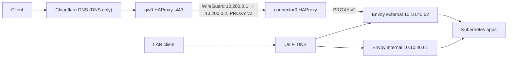

# Architecture

Nimbus Casa is a single-host homelab. Public traffic enters through a Hetzner VPS and reaches Kubernetes over a WireGuard tunnel to a home connector VM. Cloudflare only serves DNS.

Last updated: 2026-11-15

## Hosts

| Host | Address | Role | Managed by |
| --- | --- | --- | --- |
| Proxmox | `10.10.1.20` (MGMT only) | Hypervisor for every VM below | Manual; exporters by `ansible/` |
| TrueNAS Scale (`sandcrawler`) | `10.10.40.10` | NAS (PCI-passthrough disks), NFS exports, Garage S3 | Manual |
| `k8s0` | `10.10.40.40` | Single-node Talos Kubernetes cluster | `talos/`, `kubernetes/` |
| `connector0` | `10.10.40.21` | WireGuard and HAProxy endpoint for the VPS | `opentofu/`, `ansible/` |
| `nexus-kb` | `10.10.40.23` | Ubuntu 24.04 host for the Nexus application | `opentofu/`, `ansible/` |
| `gitlab0` | `10.10.40.24` | GitLab EE (Omnibus) on Ubuntu 24.04: `code.twicecooked.software` and `registry.twicecooked.software` | `opentofu/`, `ansible/` |
| `runner0` | `10.10.40.25` | Single-node Talos cluster running gitlab-runner. Untrusted CI jobs | `opentofu/`, `talos-runner/` |
| `gw0.kiad.tansanrao.net` | Hetzner | Public edge: HAProxy, WireGuard, Gatus | `ansible/` |

There is one Proxmox host, so it is the largest single point of failure.

## Network

| VLAN | Subnet | Use |
| --- | --- | --- |
| MGMT | `10.10.1.0/24` | UniFi, Proxmox and TrueNAS admin interfaces |
| LAN | `10.10.10.0/24` | Trusted user devices |
| IOT | `10.10.20.0/24` | Smart home devices, minimal egress |
| HOMELAB | `10.10.40.0/24` | Proxmox guests and services |

HOMELAB allocation:

- `10.10.40.1`: UniFi gateway.
- `10.10.40.21`–`10.10.40.39`: static VM addresses. In use: `connector0` `.21`, `nexus-kb` `.23`, `gitlab0` `.24`, `runner0` `.25`.
- `10.10.40.41`–`10.10.40.99`: Kubernetes node, Cilium LoadBalancer and service addresses. In use: SMTP relay `10.10.40.55`, Envoy internal `10.10.40.61`, Envoy external `10.10.40.62`, Dragonfly `10.10.40.71` and the authentik LDAP outpost `10.10.40.72`.
- `10.10.40.100`–`10.10.40.250`: DHCP.

Proxmox guests sit only on HOMELAB. The VPS never gets a route to MGMT, LAN, IOT or the HOMELAB subnet.

## Ingress

Public path:

1. external-dns publishes each `envoy-external` route as a CNAME to `external.nimbus.casa`. Cloudflare resolves `external.nimbus.casa` to `gw0.kiad.tansanrao.net`. Records are DNS-only.
2. VPS HAProxy redirects port 80 to HTTPS and passes TLS on port 443 through, unterminated, to `10.200.0.2:443` with PROXY protocol v2.
3. `connector0` accepts only the VPS WireGuard peer on port 443 and forwards to Envoy external with PROXY v2.
4. Envoy terminates TLS with cert-manager certificates and routes by hostname.

On the home network, UniFi resolves `external.nimbus.casa` directly to `10.10.40.62`. Envoy external accepts connections with or without a PROXY header so both paths work. LAN clients could spoof that header, so this listener should only be reachable from trusted networks and the connector. Routes on `envoy-internal` resolve only in UniFi DNS.

WireGuard peers allow only each other's `/32` (`10.200.0.1` and `10.200.0.2`). nftables on both hosts is the enforcement boundary; HAProxy only routes.

### GitLab

GitLab has its own Hetzner Floating IP, `5.161.18.14`, so git SSH can use port 22 while gw0's sshd keeps the primary address. Its public A records are managed by hand, outside external-dns.

1. nftables on gw0 rewrites `5.161.18.14` ports 22, 80 and 443 to 10022, 10080 and 10443. HAProxy forwards those as TCP with PROXY v2 to the same ports on `10.200.0.2`.
2. connector0 accepts them only from `10.200.0.1` on `wg0` and forwards them, still with the client's PROXY header, to the same ports on `10.10.40.24`.
3. On gitlab0, HAProxy owns every client-facing port. The 100xx ports accept PROXY only from connector0 (nftables). Ports 22, 80 and 443 take direct LAN, HOMELAB and runner0 connections, which cannot send a header. Both sets forward with PROXY v2 to Omnibus nginx (`127.0.0.1:80/443`) and `gitlab-sshd` (`127.0.0.1:2222`), which require it. GitLab therefore logs real client addresses on every path.
4. nginx terminates TLS with one Let's Encrypt certificate for both hostnames, issued over HTTP-01 through the same path. Admin OpenSSH on gitlab0 is on port 2022.

runner0 is limited by the Proxmox VM firewall, outside the VM: it may reach `10.10.40.24:443`, gateway DNS and the public internet, and nothing else private. Only it has a VM-level firewall; the datacenter firewall is on with ACCEPT policies and the node firewall is off. runner0 has no Flux and never holds the repository's age key; `task runner:deploy` installs gitlab-runner from a workstation.

Cloudflare Tunnel was removed from the cluster in April 2026. `nexus-kb` is the exception: a separate Cloudflare tunnel on that host forwards `app.nexus-kb.com` (see [ansible/README.md](ansible/README.md)).

## Kubernetes

Flux reconciles `kubernetes/` from this repository. Talos 1.14 runs Kubernetes 1.37 on `k8s0`, with Cilium for networking and policy and Envoy Gateway for ingress. Apps are split into namespaces with default-deny Cilium policies; see [docs/workload-isolation.md](docs/workload-isolation.md).

Storage:

- `openebs-lvm`: thin-provisioned LVM on the node's second NVMe. Application PVCs are backed up by VolSync with restic. See the [OpenEBS runbook](kubernetes/apps/openebs-system/openebs/README.md).
- `nfs-immich` and `nfs-mediastore`: TrueNAS NFS exports, backed up on the NAS.

Databases run in Kubernetes, managed by operators:

| CloudNativePG cluster | Databases |
| --- | --- |
| `authentik/auth` | authentik |
| `media-database/media` | Radarr, Sonarr, Sonarr Anime, Prowlarr, Jellystat |
| `immich/immich-db` | Immich (VectorChord image) |
| `database/postgres` | Mealie, Miniflux |
| `database/paradedb` | Links (with `pg_search` and `vector`); an empty `app` database for upcoming apps |

All clusters run PostgreSQL 18 with one instance. The Barman Cloud plugin archives WAL continuously and takes a base backup daily at 07:00 UTC to `s3://crunchy-pgo/cnpg/<cluster>/` on Garage, kept for 14 days. Off-site copies come from replicating Garage as a whole, which is not set up yet. `scripts/check-postgres.py --live` checks cluster health, WAL archiving and backup age.

Dragonfly in `database` and `immich` provides the Redis-compatible cache.

## Configuration layers

- Flux (`kubernetes/`) owns everything in the cluster.
- OpenTofu (`opentofu/proxmox/`) creates the `connector0`, `nexus-kb`, `gitlab0` and `runner0` VMs and runner0's Proxmox firewall. The VPS was created by hand.
- Ansible (`ansible/`) configures the VPS, `connector0`, `nexus-kb` and `gitlab0`.
- talhelper (`talos-runner/`) configures `runner0`; its helmfile deploys gitlab-runner.

Every host and the cluster run in UTC, and schedules are written in UTC. Daily jobs that matter to users, such as backups, upgrades and reboots, run between 07:00 and 09:00 UTC, which is 02:00 to 04:00 EST or 03:00 to 05:00 EDT, quiet hours on the US East Coast all year. Backups start at 07:00, Ubuntu hosts install upgrades from 07:00 and reboot at 08:30 when an upgrade needs it, and Recyclarr syncs at 08:00. TrueNAS scrubs its pools from Sunday 07:00 when the last scrub is over 35 days old; that schedule lives in TrueNAS, not here. Kubernetes CronJobs use the cluster's UTC clock even when the pod sets `TZ`.

Secrets are SOPS-encrypted with age: `*.sops.yaml` in `kubernetes/` and `talos/`, `group_vars/*.sops.yml` in `ansible/`. Kubernetes apps also read secrets from 1Password through External Secrets. Keep secrets out of OpenTofu state.

## Alerting

Prometheus, Alertmanager and Grafana run in `observability` and are served on `envoy-internal` at `prometheus.tansanrao.net`, `alertmanager.tansanrao.net` and `grafana.tansanrao.net`, with a `*.tansanrao.net` certificate on a listener of its own. UniFi DNS is the only resolver for these names; Cloudflare has no record. Fluent Bit ships every container's logs to VictoriaLogs in the same namespace, which keeps 7 days or 50 GiB and serves `logs.tansanrao.net`.

Prometheus also scrapes the hosts outside Kubernetes, from k8s0's node address `10.10.40.40`: node_exporter on Proxmox, TrueNAS (`sandcrawler`), `connector0`, `nexus-kb` and `gw0`; NVMe health on Proxmox through node_exporter's textfile collector; smartctl_exporter on TrueNAS; pve-exporter on Proxmox; HAProxy on `connector0` and `gw0`; and Garage. `gw0`'s exporters are reached through TCP relays on `connector0` (ports 9101 and 9102) over WireGuard. Each host's `instance` label is its hostname. The hosts send their journals with `systemd-journal-upload` to `logs.tansanrao.net/insert/journald`, which accepts only their addresses; `gw0` sends plain HTTP over WireGuard to `connector0`'s logs relay, which allows only journald uploads and forwards them over TLS. TrueNAS runs its exporters and Fluent Bit as a custom app (`truenas/monitoring/`).

Alertmanager in `observability` sends warnings to Pushover at normal priority every 12 h and critical alerts at high priority every 4 h. Its always-firing `Watchdog` alert is a heartbeat: every 5 minutes it posts to Gatus on `gw0` at `https://gw0.kiad.tansanrao.net/api/v1/endpoints/monitoring_alertmanager/external` with a bearer token, over the internet rather than the tunnel. Gatus pages through Pushover when no heartbeat arrives for 15 minutes, which covers Alertmanager, Prometheus, the cluster, the home connection and the Proxmox host being down.

On `gw0`, HAProxy terminates TLS only for `gw0.kiad.tansanrao.net` and `status.tansanrao.net`, with one Let's Encrypt certificate for both. It passes `POST` requests for Gatus's external endpoint API, and `GET` and `HEAD` requests for `status.tansanrao.net` to Gatus's read-only UI, except `/metrics`; everything else gets 403. certbot validates with the HTTP-01 challenge: HAProxy sends `/.well-known/acme-challenge/` for those hostnames on port 80 to certbot's standalone server on `127.0.0.1:8402`, so no DNS API credentials are involved. Every other hostname is still passed through to Kubernetes, and Gatus itself listens on `127.0.0.1` only.

## Not built yet

- L7 TLS termination on the VPS for services on separate VMs. The HAProxy map `vm-services.map` exists but is unused, so every TLS connection goes to Kubernetes.
- External checks from the VPS. Gatus on `gw0` only watches Alertmanager's heartbeat; in-cluster Gatus covers internal checks.
- A narrower Proxmox role for the OpenTofu API token, which currently has `Administrator`.
- Off-site replication of Garage.

## Risks

- One Proxmox host, one Kubernetes node and one NAS.
- PostgreSQL data lives on single-node `openebs-lvm` volumes. Recovery depends on the Garage backups, so test restores and replicate Garage off-site.
- The VPS is internet-facing and holds a WireGuard key into HOMELAB. Keep its firewall tight, its packages patched and its services minimal.
- TLS passthrough keeps certificates in one place but gives the VPS no HTTP-level visibility. Its logs carry client IPs, not hostnames or paths.
