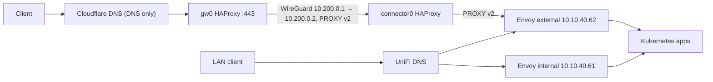

# Architecture

Nimbus Casa is a single-host homelab. Public traffic enters through a Hetzner VPS and reaches Kubernetes over a WireGuard tunnel to a home connector VM. Cloudflare only serves DNS.

Last updated: 2026-11-14

## Hosts

| Host | Address | Role | Managed by |
| --- | --- | --- | --- |
| Proxmox | `10.10.1.20` (MGMT), `10.10.40.20` | Hypervisor for every VM below | Manual |
| TrueNAS Scale | `10.10.40.10` | NAS (PCI-passthrough disks), NFS exports, Garage S3 | Manual |
| `k8s0` | `10.10.40.40` | Single-node Talos Kubernetes cluster | `talos/`, `kubernetes/` |
| `connector0` | `10.10.40.21` | WireGuard and HAProxy endpoint for the VPS | `opentofu/`, `ansible/` |
| `nexus-kb` | `10.10.40.23` | Ubuntu 24.04 host for the Nexus application | `opentofu/`, `ansible/` |
| `gw0.kiad.tansanrao.net` | Hetzner | Public edge: HAProxy, WireGuard, Gatus | `ansible/` |

There is one Proxmox host, so it is the largest single point of failure.

## Network

| VLAN | Subnet | Use |
| --- | --- | --- |
| MGMT | `10.10.1.0/24` | UniFi, Proxmox and TrueNAS admin interfaces |
| LAN | `10.10.10.0/24` | Trusted user devices |
| IOT | `10.10.20.0/24` | Smart home devices, minimal egress |
| HOMELAB | `10.10.40.0/24` | Proxmox guests and services |

HOMELAB allocation:

- `10.10.40.1`: UniFi gateway.
- `10.10.40.21`–`10.10.40.39`: static VM addresses.
- `10.10.40.41`–`10.10.40.99`: Kubernetes node, Cilium LoadBalancer and service addresses. In use: SMTP relay `10.10.40.55`, Envoy internal `10.10.40.61`, Envoy external `10.10.40.62`, Dragonfly `10.10.40.71` and the authentik LDAP outpost `10.10.40.72`.
- `10.10.40.100`–`10.10.40.250`: DHCP.

Proxmox guests sit only on HOMELAB. The VPS never gets a route to MGMT, LAN, IOT or the HOMELAB subnet.

## Ingress

Public path:

1. external-dns publishes each `envoy-external` route as a CNAME to `external.nimbus.casa`. Cloudflare resolves `external.nimbus.casa` to `gw0.kiad.tansanrao.net`. Records are DNS-only.
2. VPS HAProxy redirects port 80 to HTTPS and passes TLS on port 443 through, unterminated, to `10.200.0.2:443` with PROXY protocol v2.
3. `connector0` accepts only the VPS WireGuard peer on port 443 and forwards to Envoy external with PROXY v2.
4. Envoy terminates TLS with cert-manager certificates and routes by hostname.

On the home network, UniFi resolves `external.nimbus.casa` directly to `10.10.40.62`. Envoy external accepts connections with or without a PROXY header so both paths work. LAN clients could spoof that header, so this listener should only be reachable from trusted networks and the connector. Routes on `envoy-internal` resolve only in UniFi DNS.

WireGuard peers allow only each other's `/32` (`10.200.0.1` and `10.200.0.2`). nftables on both hosts is the enforcement boundary; HAProxy only routes.

Cloudflare Tunnel was removed from the cluster in April 2026. `nexus-kb` is the exception: a separate Cloudflare tunnel on that host forwards `app.nexus-kb.com` (see [ansible/README.md](ansible/README.md)).

## Kubernetes

Flux reconciles `kubernetes/` from this repository. Talos 1.14 runs Kubernetes 1.37 on `k8s0`, with Cilium for networking and policy and Envoy Gateway for ingress. Apps are split into namespaces with default-deny Cilium policies; see [docs/workload-isolation.md](docs/workload-isolation.md).

Storage:

- `openebs-lvm`: thin-provisioned LVM on the node's second NVMe. Application PVCs are backed up by VolSync with restic. See the [OpenEBS runbook](kubernetes/apps/openebs-system/openebs/README.md).
- `nfs-immich` and `nfs-mediastore`: TrueNAS NFS exports, backed up on the NAS.

Databases run in Kubernetes, managed by operators:

| CloudNativePG cluster | Databases |
| --- | --- |
| `authentik/auth` | authentik |
| `media-database/media` | Radarr, Sonarr, Sonarr Anime, Prowlarr, Jellystat |
| `immich/immich-db` | Immich (VectorChord image) |
| `database/postgres` | Mealie, Miniflux |
| `database/paradedb` | Empty `app` database with `pg_search`, for upcoming apps |

All clusters run PostgreSQL 18 with one instance. The Barman Cloud plugin archives WAL continuously and takes a base backup daily at 03:00 to `s3://crunchy-pgo/cnpg/<cluster>/` on Garage, kept for 14 days. Off-site copies come from replicating Garage as a whole, which is not set up yet. `scripts/check-postgres.py --live` checks cluster health, WAL archiving and backup age.

Dragonfly in `database` and `immich` provides the Redis-compatible cache. Karakeep uses SQLite.

## Configuration layers

- Flux (`kubernetes/`) owns everything in the cluster.
- OpenTofu (`opentofu/proxmox/`) creates the `connector0` and `nexus-kb` VMs. The VPS was created by hand.
- Ansible (`ansible/`) configures the VPS, `connector0` and `nexus-kb`.

Secrets are SOPS-encrypted with age: `*.sops.yaml` in `kubernetes/` and `talos/`, `group_vars/*.sops.yml` in `ansible/`. Kubernetes apps also read secrets from 1Password through External Secrets. Keep secrets out of OpenTofu state.

## Not built yet

- L7 TLS termination on the VPS for services on separate VMs. The HAProxy map `vm-services.map` exists but is unused, so every TLS connection goes to Kubernetes.
- External checks from the VPS. Gatus is installed on `gw0` with no endpoints configured; in-cluster Gatus covers internal checks.
- A narrower Proxmox role for the OpenTofu API token, which currently has `Administrator`.
- Off-site replication of Garage.

## Risks

- One Proxmox host, one Kubernetes node and one NAS.
- PostgreSQL data lives on single-node `openebs-lvm` volumes. Recovery depends on the Garage backups, so test restores and replicate Garage off-site.
- The VPS is internet-facing and holds a WireGuard key into HOMELAB. Keep its firewall tight, its packages patched and its services minimal.
- TLS passthrough keeps certificates in one place but gives the VPS no HTTP-level visibility. Its logs carry client IPs, not hostnames or paths.
